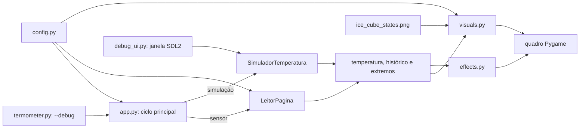

# Guia do projeto para apresentação de Computação Gráfica

## 1. O que o projeto faz

O projeto é um painel 2D desenvolvido com Pygame. Ele apresenta uma temperatura lida de um sensor pela rede ou simulada pelo computador. A interface relaciona essa temperatura a cores, à altura de um termômetro, a um gráfico histórico e à aparência de um cubo de gelo que derrete. Partículas e movimento dão vida ao cenário.

O projeto tem dois modos:

- **Sensor:** consulta a página configurada em `config.py`; a escala visual vai de 0 a 50 °C.
- **Simulação:** inicia com `python termometer.py --debug`, não acessa a rede e percorre a escala de 0 a 100 °C.

## 2. Mapa dos arquivos

| Arquivo | Responsabilidade | O que mostrar na apresentação |
|---|---|---|
| `termometer.py` | Ponto de entrada e leitura de argumentos do terminal. | O argumento `--debug` seleciona o modo simulado e chama `main`. |
| `app.py` | Inicializa o Pygame e coordena o ciclo principal da aplicação. | Eventos, atualização da temperatura, ordem de desenho e atualização da tela. |
| `config.py` | Reúne limites, dimensões, endereço do sensor, caminho do sprite e parâmetros visuais. | Como constantes centralizadas permitem ajustar o projeto sem procurar valores espalhados. |
| `thermal.py` | Converte a resposta web em temperatura, lê o sensor em segundo plano e implementa a simulação. | Thread, proteção por `Lock`, histórico e movimento gradual entre os limites. |
| `visuals.py` | Cria o ícone e desenha o fundo, termômetro, gráfico e gelo interpolado. | Coordenadas 2D, cores RGB, alpha blending, sprites e cache de quadros. |
| `effects.py` | Cria, atualiza e desenha neve, bolhas, gotas, vapor e brasas. | Movimento com `dt`, movimento oscilatório e limite de partículas. |
| `debug_ui.py` | Implementa a segunda janela SDL2 com direção, velocidade e reinício. | Interface interativa, posição do mouse, slider e eventos de múltiplas janelas. |
| `requirements.txt` | Lista as dependências Python e suas versões fixadas. | Pygame para gráficos, Requests para HTTP e BeautifulSoup para interpretar HTML. |
| `.gitignore` | Evita versionar `.venv`, caches e bytecode Python. | Diferença entre arquivos-fonte e arquivos locais gerados durante a execução. |
| `assets/ice_cube_states.png` | Spritesheet horizontal com quatro estados do gelo. | Cada quadro representa uma fase: cubo sólido, derretimento progressivo e poça. |
| `.venv/` | Ambiente virtual local criado para este projeto; não é enviado ao Git. | Isola as bibliotecas do projeto das bibliotecas instaladas globalmente no computador. |

### Arquivo de geração do spritesheet

`gerar_sprites_gelo.py` não está presente na pasta atualmente e aparece como removido no estado do Git. O aplicativo em execução não depende desse script: ele carrega `assets/ice_cube_states.png`. Portanto, é possível apresentar e executar o painel com o spritesheet já existente, mas regenerá-lo exige recuperar ou reescrever o gerador.

## 3. Arquitetura e fluxo dos dados



No modo de sensor, `LeitorPagina` consulta a página a cada dois segundos em uma thread separada. O ciclo gráfico continua responsivo enquanto a rede aguarda uma resposta. O `Lock` protege os dados compartilhados: a thread escreve a leitura e a interface obtém uma cópia consistente.

No modo de simulação, `SimuladorTemperatura.atualizar(dt)` avança a temperatura com base no tempo decorrido. A janela de depuração permite escolher a direção e a velocidade. A simulação para em 0 °C ou 100 °C.

Em cada quadro, `app.main()` processa eventos, atualiza o estado e desenha o fundo, as partículas, as leituras, o gelo e o gráfico. `pygame.display.flip()` apresenta o quadro completo na janela.

## 4. Conceitos gráficos importantes

### 4.1 Coordenadas 2D e rasterização

O Pygame desenha em uma superfície formada por pixels. Os elementos são posicionados em coordenadas `(x, y)`: por exemplo, o cubo fica próximo de `(665, 155)` e o gráfico ocupa a parte inferior da tela. Retângulos, círculos, linhas e elipses são rasterizados para formar o termômetro, partículas, controles e detalhes do gelo.

No eixo vertical, valores menores de `y` ficam mais perto do topo da janela. Por isso o nível do líquido do termômetro é calculado subtraindo uma fração da altura disponível.

### 4.2 Mapeamento da temperatura para a aparência

Uma grandeza física é convertida em uma proporção visual entre 0 e 1:

```text
proporção = (temperatura - mínimo) / (máximo - mínimo)
```

Essa proporção controla a altura do líquido, o tom do fundo, a fase do gelo e a densidade dos efeitos. No modo de simulação, a faixa de 0 a 100 °C é normalizada para reutilizar a paleta de cores definida para 0 a 50 °C.

`cor_da_temperatura()` interpola entre pontos de cor. Se a temperatura estiver entre dois pontos, calcula uma mistura proporcional para cada canal RGB. Assim, a mudança de azul para vermelho é gradual, em vez de usar apenas cores fixas.

### 4.3 Gradiente térmico

`desenhar_gradiente()` mistura duas cores no topo e duas na base da tela. Em seguida, interpola verticalmente entre topo e base para construir o gradiente. A temperatura controla a mistura entre o tema frio e o quente.

O resultado é armazenado em cache com 201 níveis possíveis de temperatura normalizada. Isso evita reconstruir os 600 pixels verticais do gradiente em todos os quadros quando a temperatura praticamente não mudou.

### 4.4 Sprite e interpolação do derretimento

`assets/ice_cube_states.png` contém quatro imagens do gelo. `carregar_quadros_gelo()` divide a faixa horizontal em quadros independentes e os redimensiona para a interface.

`desenhar_gelo()` transforma a temperatura em uma posição fracionária entre quadros vizinhos. `quadro_interpolado_gelo()` mistura os canais RGBA dos dois sprites, gerando até 120 passos entre cada par. A mistura também considera o canal alfa, que controla a transparência das bordas.

O quadro interpolado fica em cache. Isso reduz o trabalho de composição quando a mesma temperatura arredondada aparece em vários quadros consecutivos. Além da mudança de forma, o cubo oscila alguns pixels e recebe um anel luminoso pulsante.

### 4.5 Partículas e animação no tempo

`SistemaParticulas` escolhe os efeitos a partir da temperatura: neve e bolhas no frio, gotas e vapor durante o derretimento, e brasas no calor. Cada partícula guarda posição, velocidade, fase e raio.

O movimento usa `dt`, o tempo desde o quadro anterior. Isso expressa velocidades em unidades por segundo, reduzindo a dependência da animação em relação ao número de quadros por segundo. A função seno adiciona oscilação lateral ou vertical suave; as partículas que saem da região visível retornam à área de desenho.

### 4.6 Suavização e apresentação dos quadros

`app.main()` atualiza a leitura exibida gradualmente em direção à temperatura recebida. Isso reduz saltos visuais entre amostras. O ciclo é limitado a 60 quadros por segundo e restringe `dt` a 0,1 segundo para evitar grandes saltos após uma pausa momentânea.

O desenho ocorre em uma superfície antes da chamada a `pygame.display.flip()`. Essa apresentação em lote evita mostrar parcialmente um quadro enquanto seus elementos ainda estão sendo desenhados.

## 5. Trechos para destacar durante a apresentação

1. **Normalização e cor:** `visuals.py` → `cor_da_temperatura()` e `desenhar_gradiente()`.
2. **Geometria do termômetro:** `visuals.py` → `desenhar_termometro()`.
3. **Interpolação de imagens:** `visuals.py` → `quadro_interpolado_gelo()` e `desenhar_gelo()`.
4. **Animação baseada em tempo:** `effects.py` → `SistemaParticulas.atualizar()`.
5. **Ciclo de renderização:** `app.py` → `main()`.
6. **Separação entre lógica e visualização:** `thermal.py` produz dados; `visuals.py` os transforma em elementos gráficos.

## 6. Como executar

No PowerShell, dentro da pasta do projeto:

```powershell
.\.venv\Scripts\Activate.ps1
python termometer.py --debug
```

Para instalar as dependências em um ambiente virtual novo:

```powershell
python -m venv .venv
.\.venv\Scripts\Activate.ps1
python -m pip install -r requirements.txt
```

## 7. Limitações que podem ser mencionadas

- O modo sensor depende do endereço de rede configurado em `config.py` e de uma resposta HTML que contenha uma temperatura reconhecível.
- A animação do gelo mistura quatro estados 2D já desenhados; não é uma simulação física nem uma malha 3D deformável.
- As partículas são formas 2D simples e decorativas, limitadas à região ao redor do cubo.
- O cache da interpolação usa mistura de pixels RGBA; isso suaviza a troca entre sprites, mas não altera a geometria original do desenho.
